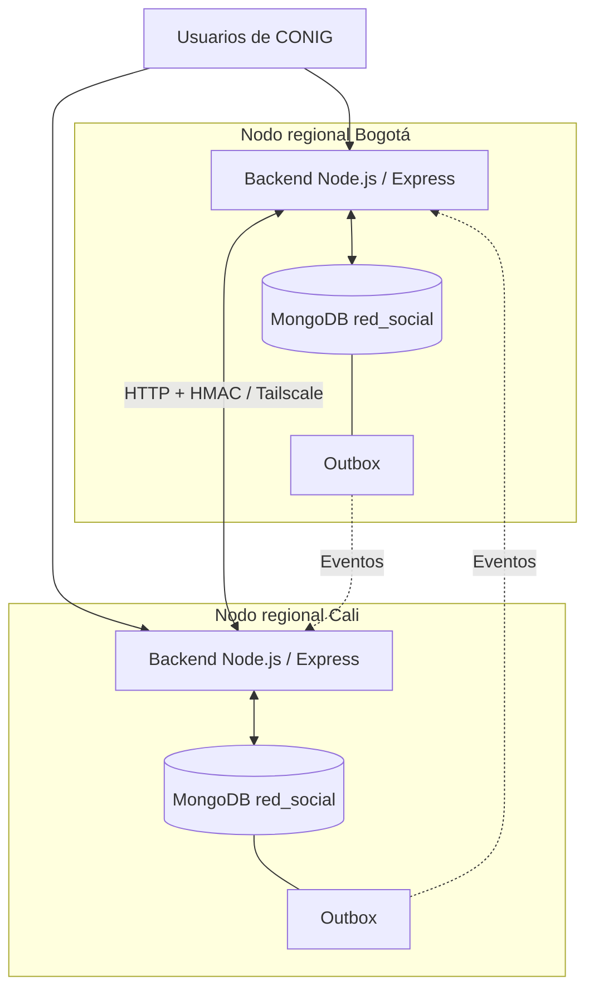

# 🌐 CONIG — Red Social Distribuida

**Proyecto académico de Bases de Datos Distribuidas**

CONIG es una red social web desarrollada bajo una arquitectura distribuida, cuyo objetivo es permitir que usuarios de diferentes regiones puedan registrarse, publicar contenido, seguir a otros usuarios e intercambiar mensajes, utilizando nodos regionales independientes que sincronizan información mediante mecanismos de replicación a nivel de aplicación.

La infraestructura actual está compuesta por dos nodos regionales: **Bogotá y Cali**, cada uno con su propio backend y base de datos MongoDB.

## 🚀 Aplicación

- **Aplicación web:** https://conig-redsocial-web.onrender.com/login.html
- **Repositorio:** https://github.com/SrInviMendez/RedSocialCONIG

## 🎯 Objetivos del proyecto

- Implementar una arquitectura de base de datos distribuida.
- Distribuir la información entre diferentes nodos regionales.
- Implementar replicación asíncrona y consistencia eventual.
- Aplicar transacciones ACID en operaciones locales.
- Implementar fragmentación horizontal de publicaciones.
- Garantizar la comunicación segura entre nodos.
- Analizar el comportamiento del sistema frente al teorema CAP.
- Evaluar la tolerancia a fallos y las particiones de red.

## 🏗️ Arquitectura del sistema

La arquitectura está compuesta por dos nodos independientes a nivel lógico:

| Componente | Bogotá | Cali |
|---|---|---|
| Sistema operativo | Ubuntu Server | Ubuntu Server |
| Backend | Node.js + Express | Node.js + Express |
| Base de datos | MongoDB | MongoDB |
| Base de datos lógica | red_social | red_social |
| Replica Set | rsBogota | rsCali |
| Comunicación | Tailscale | Tailscale |

Cada nodo dispone de su propia instancia de MongoDB y backend. La comunicación entre regiones se realiza mediante direcciones privadas de Tailscale y solicitudes HTTP protegidas mediante firmas HMAC.

**Importante:** cada Replica Set tiene actualmente un solo miembro PRIMARY. La replicación entre Bogotá y Cali se realiza mediante la lógica de la aplicación, no mediante un Replica Set geográficamente compartido.

### Diagrama de arquitectura

## 🛠️ Tecnologías utilizadas

| Tecnología | Función |
|---|---|
| Node.js | Entorno de ejecución del backend |
| Express.js | Desarrollo de la API REST |
| MongoDB | Almacenamiento documental |
| Ubuntu Server | Sistema operativo de los nodos |
| VirtualBox | Virtualización de servidores |
| Tailscale | Comunicación privada entre nodos |
| WireGuard | Cifrado de las comunicaciones de red |
| JWT | Autenticación de usuarios |
| bcryptjs | Hash de contraseñas |
| HMAC-SHA256 | Firma y verificación de eventos |
| Outbox Pattern | Gestión y replicación de eventos |

## ✨ Funcionalidades implementadas

### 👤 Gestión de usuarios
- Registro de usuarios.
- Inicio de sesión.
- Autenticación mediante JWT.
- Almacenamiento seguro de contraseñas mediante bcrypt.
- Replicación de usuarios entre Bogotá y Cali.
- Autenticación cruzada entre regiones.

### 📝 Publicaciones
- Creación de publicaciones.
- Almacenamiento local según la región de origen.
- Consulta del muro distribuido.
- Integración de publicaciones de diferentes regiones.
- Ordenamiento cronológico de publicaciones.

### 👥 Seguidores
- Seguir usuarios.
- Dejar de seguir usuarios.
- Consultar relaciones de seguimiento.
- Replicación de eventos de seguimiento entre nodos.

### 💬 Mensajería privada
- Envío de mensajes entre usuarios.
- Creación y consulta de conversaciones.
- Sincronización de mensajes entre regiones.
- Estados de entrega y lectura.
- Protección de conversaciones mediante validación de pertenencia.

## 🗄️ Modelo de datos

La base de datos `red_social` contiene las siguientes colecciones:

| Colección | Responsabilidad |
|---|---|
| `users` | Usuarios y perfiles |
| `posts` | Publicaciones regionales |
| `follows` | Relaciones entre seguidores |
| `conversations` | Conversaciones privadas |
| `messages` | Mensajes y estados |
| `outbox` | Eventos pendientes de replicación |
| `processed_events` | Control de eventos procesados |
| `audit_logs` | Estructura para registros de auditoría |

## 🔄 Replicación y consistencia eventual

CONIG utiliza el patrón **Transactional Outbox** para sincronizar información entre los nodos.

El funcionamiento general es:

1. Se realiza una operación en el nodo local.
2. Se guarda la información y su evento Outbox dentro de una transacción.
3. Un worker revisa periódicamente los eventos pendientes.
4. El evento se envía al nodo remoto mediante HTTP.
5. El receptor verifica la firma HMAC.
6. Se registra la información y el identificador del evento procesado.
7. El emisor marca el evento como entregado.

Este mecanismo permite que las operaciones locales no dependan permanentemente de la disponibilidad del nodo remoto.

La sincronización es asíncrona, por lo que los nodos pueden presentar diferencias temporales hasta alcanzar la consistencia eventual.

## 📦 Fragmentación horizontal

Las publicaciones utilizan fragmentación horizontal por región de origen, mediante el atributo `sourceRegion`.

- Bogotá almacena las publicaciones creadas en Bogotá.
- Cali almacena las publicaciones creadas en Cali.
- El muro consulta los fragmentos locales y remotos.
- El backend combina y ordena los resultados.

La fragmentación está implementada en la capa de aplicación. No se utiliza un clúster Sharded de MongoDB.

## 🔐 Seguridad

El proyecto incorpora los siguientes mecanismos:

- Autenticación de usuarios mediante JWT.
- Hash de contraseñas mediante bcryptjs.
- Autenticación de usuarios técnicos en MongoDB.
- Roles y permisos de acceso a las bases de datos.
- Firmas HMAC para verificar eventos de replicación.
- Comunicación privada cifrada mediante Tailscale y WireGuard.
- Variables de entorno para proteger credenciales y secretos.

**Las credenciales y secretos de configuración no deben publicarse en el repositorio.**

## ⚛️ Propiedades ACID

Se utilizan transacciones locales de MongoDB para garantizar:

- **Atomicidad:** las operaciones relacionadas se confirman juntas o se cancelan.
- **Consistencia:** se mantienen las reglas y validaciones de los datos.
- **Aislamiento:** las operaciones utilizan el aislamiento transaccional del motor.
- **Durabilidad:** los cambios confirmados se persisten según la configuración de escritura.

Las transacciones son locales a cada nodo. No existe una transacción ACID distribuida entre Bogotá y Cali.

## 🌎 Teorema CAP

La arquitectura busca favorecer la disponibilidad y tolerancia a particiones, aceptando consistencia eventual para las operaciones que pueden realizarse localmente.

Durante una interrupción de comunicación:

- Cada nodo puede continuar con determinadas operaciones locales.
- Los eventos pendientes permanecen en Outbox.
- La sincronización se reanuda cuando se recupera la comunicación.
- Las consultas que necesitan ambos fragmentos pueden fallar si el nodo remoto no responde.

Por tanto, la disponibilidad depende de la operación solicitada y no se garantiza para todas las funcionalidades durante una partición.

## 🧪 Pruebas y validaciones

Se han realizado pruebas funcionales de:

- Comunicación entre Bogotá y Cali.
- Registro de usuarios en ambos nodos.
- Replicación de cuentas.
- Autenticación cruzada.
- Creación y consulta de publicaciones.
- Fragmentación física de publicaciones.
- Operaciones de seguimiento.
- Envío y recepción de mensajes.
- Estados de entrega y lectura.
- Control de acceso y privacidad.
- Auditoría de registros y eventos.

Las pruebas formales de caída de nodos, partición de red, Split-Brain y recuperación siguen pendientes.

## 📊 Estado del proyecto

| Componente | Estado |
|---|---|
| Infraestructura Bogotá y Cali | Implementado |
| Comunicación entre nodos | Probada |
| Registro y autenticación | Probados |
| Replicación de usuarios | Probada |
| Publicaciones y muro distribuido | Probados |
| Fragmentación horizontal | Implementada y probada |
| Seguidores | Probados |
| Mensajería privada | Probada |
| Transacciones ACID locales | Implementadas |
| Consistencia eventual | Probada en operaciones seleccionadas |
| Interfaz web completa | Pendiente |
| Comentarios | Pendiente |
| Nodo Medellín | Planeado |
| Pruebas formales CAP y Split-Brain | Pendientes |
| Failover y tolerancia a fallos | Pendientes |
| Panel de monitoreo completo | Pendiente |

## 📚 Documentación técnica

El proyecto cuenta con documentación técnica que describe:

- Arquitectura distribuida.
- Configuración de los nodos.
- Instalación y administración de Ubuntu Server.
- Comunicación mediante Tailscale.
- Modelo de datos MongoDB.
- Replicación mediante Outbox.
- Transacciones ACID.
- Seguridad y autenticación.
- Fragmentación horizontal.
- Pruebas funcionales y auditorías.
- Limitaciones y próximas etapas.

## 👨‍💻 Proyecto académico

**CONIG — Red Social Distribuida**

Desarrollado como proyecto académico para la asignatura de **Bases de Datos Distribuidas**.

**Regiones:** Bogotá y Cali, Colombia.

**Objetivo:** demostrar la implementación de una arquitectura distribuida con replicación, fragmentación horizontal, consistencia eventual y mecanismos de comunicación entre nodos regionales.
